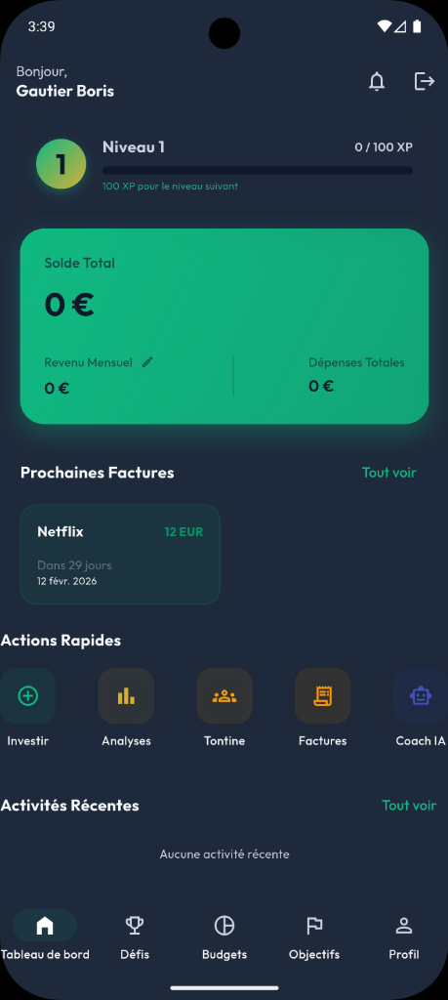

# Kauri Website

Kauri is a smart financial management platform that combines the power of AI and the solidarity of Tontines to offer total financial freedom.



## 🌟 Key Features

- **Tontines 2.0**: Securely create and manage tontines with fixed or random rotation, AI-verified payments, and total transparency.
- **AI Financial Coach**: A personal assistant that analyzes spending, detects subscriptions, and provides 24/7 financial advice.
- **Smart Capture**: Log expenses via OCR receipt scanning, voice commands, or automatic bank/Mobile Money SMS import.
- **Smart Budgeting & Goals**: Adaptive, shareable budgets and savings goals with real-time alerts and round-up savings.
- **Bank-Grade Security**: AES-256 encryption, KYC identity verification, and real-time fraud monitoring.
- **Gamification**: Earn badges and reach new levels by hitting your financial goals and challenges.
- **Multi-Currency**: Effortlessly manage finances in XAF, EUR, and USD with real-time conversion.
- **Shared Subscriptions (Reseller Hub)**: Split or resell premium subscriptions (Netflix, Spotify, Canva...) within the Kauri community.

## 🚀 Tech Stack

- **Frontend**: HTML5, Vanilla CSS, Javascript (ES6+)
- **Internationalization**: Custom i18n implementation (French & English)
- **Features**: Progressive Web App (PWA) support, intersection observers for animations, responsive design.

## 📂 Project Structure

```text
├── index.html            # Landing page (French, served at /)
├── about.html            # About / features page
├── privacy.html          # Privacy Policy
├── terms.html            # Terms of Service
├── en/                   # English versions of the four pages (served under /en/)
├── styles.css            # Styling and design system
├── scripts.js            # Core logic and internationalization
├── legal.js              # Language switch for privacy / terms
├── about.js              # Scroll-spy for the about page
├── manifest.json         # PWA manifest
├── logo.png, og-fr.jpg, og-en.jpg, app_screenshot.png
├── nginx.conf            # nginx server config (routing, caching)
├── security-headers.conf # CSP / HSTS / security headers (included by nginx.conf)
├── Dockerfile            # nginx:alpine image serving the static site
└── .github/workflows/deploy.yml  # Build → GHCR → SSH deploy (push on main)
```

## 🔒 Security Notes

- A strict **Content-Security-Policy** is sent by nginx: no inline `<script>` and no inline event handlers are allowed. Add behaviour in `scripts.js` / a dedicated `.js` file, never inline.
- Allowed third parties: Google Fonts, cdnjs (Font Awesome) and Formspree (contact form). Any new external resource must be added to `security-headers.conf`.
- TLS is terminated by the reverse proxy in front of the container (HSTS is sent by the site).

## 🛠️ Local Development

1. **Clone the repository**:
   ```bash
   git clone https://github.com/TheGoatIA/kauri-website.git
   ```
2. **Run it**:
   - Quick look: open `index.html` in a browser, or serve the folder with any static server (e.g. VS Code Live Server). The English URLs (`/en/`) need a server, not `file://`.
   - Production-like (nginx, CSP, routing): `docker build -t kauri-website . && docker run --rm -p 8080:80 kauri-website`, then open <http://localhost:8080>.

## 🌍 Languages

The website currently supports:
- 🇫🇷 Français
- 🇺🇸 English

## 📄 License

This project is licensed under the MIT License - see the [LICENSE](LICENSE) file for details.

## 📧 Contact

For any inquiries, reach us at:  
**Email**: infos@kauri-app.com  
**Location**: Service Kauri, Douala, Cameroon.
